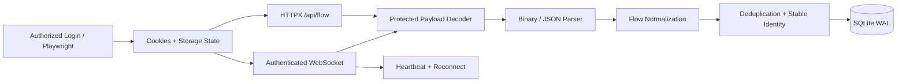

# OptionStrat Flow Decoder & Real-Time Data Monitor

A compact but technically deep backend/data-engineering project that captures authenticated OptionStrat flow data, decodes the platform's protected binary payloads, normalizes option-flow events, and persists both historical and live updates into SQLite.

> **Portfolio scope:** this repository demonstrates authenticated browser-session reuse, protocol inspection, protected-payload decoding, HTTPX integration, binary WebSocket parsing, event normalization, deduplication, and durable storage. Real credentials, cookies, session files, and production flow data are intentionally excluded.

## Why This Was Not a Normal Scraper

The target data was not exposed as simple HTML or plain JSON that could be scraped with a few selectors.

The workflow required several layers:

1. authenticate through the real web application;
2. persist the authorized browser session;
3. reuse that session outside the browser with HTTPX and WebSocket clients;
4. identify the application's internal Flow API and live WebSocket protocol;
5. reproduce the client-side protected-payload decoder from the site's JavaScript behavior;
6. decode binary HTTP/WebSocket payloads into JSON;
7. normalize OptionStrat-specific strategy and option structures;
8. deduplicate historical and live events;
9. store the resulting stream in SQLite while keeping the connection live.

The difficult part was therefore **protocol understanding and decoding**, not DOM scraping.

## My Contribution

I built the complete data pipeline around the OptionStrat Flow source, including:

- Playwright-based authenticated login.
- Persisting cookies and browser storage state for an authorized session.
- Reusing Playwright cookies with `httpx.AsyncClient`.
- Calling the authenticated `/api/flow` endpoint.
- Detecting protected responses through the `x-protect` response header.
- Reimplementing the site's client-side protected-array decoding routine in Python.
- Connecting to the live Flow WebSocket using the authenticated Cookie header and OptionStrat subprotocol.
- Decoding protected binary WebSocket frames.
- Parsing the platform's message type byte and 7-bit encoded JSON length.
- Maintaining flow cursors for incremental live updates.
- Normalizing option strategies, strikes, expirations, dates, option types, and premiums.
- Handling mixed call/put strategies without silently discarding them.
- Generating stable identities with source IDs or SHA-256 fallback hashes.
- Persisting options and insider-flow events with SQLite UPSERTs.
- Using WAL mode so downstream readers can query while the monitor continues writing.
- Implementing heartbeat/reconnect behavior for the long-running WebSocket monitor.

## Protected Payload Decoding

The response protection was reproduced from the decoding behavior used by the web client.

At a high level, a protected payload has this structure:

```text
byte 0        byte 1        remaining bytes
+-------------+-------------+-----------------------------+
| correction  | XOR value   | protected raw-deflate data  |
| index       |             |                             |
+-------------+-------------+-----------------------------+
```

The Python decoder performs:

```text
Protected bytes
    ↓
Read correction index + XOR value
    ↓
XOR each compressed byte with (index % xor_value)
    ↓
Raw DEFLATE decompression
    ↓
Correct one decoded byte at correction_index using XOR
    ↓
Decoded application payload
```

The implementation is in:

```python
optionstrat_flow_monitor.py::decrypt_protected_array
```

For HTTP responses, the decoded bytes are UTF-8 JSON. For WebSocket frames, the decoded payload has an additional binary protocol layer.

## Binary WebSocket Protocol

After protected-array decoding, a live WebSocket message contains:

```text
[message_type][7-bit encoded JSON length][JSON bytes]
```

The monitor handles message types such as:

- new options flow
- news flow
- government flow
- insider flow
- ping
- pong

The 7-bit integer parser and binary frame decoder are implemented in:

```python
read_7bit_encoded_int(...)
decode_websocket_message(...)
```

This allowed the system to consume the same live stream used by the web application without relying on DOM scraping or browser rendering.

## Architecture



## Historical + Live Synchronization

At startup the monitor first calls `/api/flow` to obtain the current historical snapshot and initial cursors. It then opens the live WebSocket using those cursors so new events can continue from the correct point.

This avoids treating the system as two unrelated scrapers. Historical synchronization and live monitoring share the same normalization and persistence path.

## Session Handling

`optionstrat_login.py` uses Playwright to:

- open the login page;
- submit credentials from environment variables;
- wait for a successful authenticated redirect;
- verify that the protected Flow page can be opened;
- save cookies and Playwright storage state locally.

The monitor then converts those saved cookies into both:

- an `httpx.Cookies` jar for the HTTP API;
- a `Cookie` header for the WebSocket handshake.

No credentials or real session files are committed to this repository.

## Data Normalization

The source payload is normalized into a compact downstream schema containing fields such as:

- symbol
- strategy
- strike
- option type
- expiration
- flow date
- time
- premium

The code also includes a strategy-definition map so Call-only, Put-only, mixed, and stock strategies can be classified safely instead of assuming every flow record is a simple single-leg contract.

See `docs/DATA_SCHEMA.md` and `examples/flow_sample.json`.

## Persistence Design

SQLite is configured with:

```text
journal_mode = WAL
synchronous = NORMAL
```

This allows a backend/dashboard process to read the database while the monitor continues writing live events.

Events use source IDs when available, otherwise a canonical JSON representation is hashed with SHA-256 to provide deterministic deduplication.

## Resilience

The live monitor includes:

- session-expiry detection for redirects / HTTP 401 / HTTP 403;
- custom ping/pong handling;
- heartbeat timeout detection;
- reconnect with jitter;
- binary-decode error handling;
- storage of failed raw responses locally for debugging;
- database migrations for newly introduced columns.

## Tech Stack

- Python
- Playwright
- HTTPX / HTTP/2
- WebSockets
- asyncio
- zlib / Raw DEFLATE
- binary protocol parsing
- SHA-256 hashing
- SQLite / WAL

## Public Repository Structure

```text
optionstrat_login.py
optionstrat_flow_monitor.py
requirements.txt
.env.example
examples/
  flow_sample.json
docs/
  DATA_SCHEMA.md
tests/
  test_decoder.py
SECURITY.md
```

## Tests

The repository includes synthetic decoder tests. They create a test payload using the reverse of the public decode transformation, then verify both:

- protected-array round-trip decoding;
- binary WebSocket message decoding.

No real captured OptionStrat payload is required for the tests.

Run:

```bash
python -m pytest -q
```

## Local Setup

```bash
python -m venv .venv
pip install -r requirements.txt
playwright install chromium
```

Create `.env` from `.env.example` and use only an account you are authorized to access.

Then authenticate locally:

```bash
python optionstrat_login.py
```

After the local session is created:

```bash
python optionstrat_flow_monitor.py
```

## Security

The original development archive included real credentials/session material and populated production data. Those are excluded from this portfolio snapshot.

See `SECURITY.md`.

## Author

**Hassan Ali Hassan**  
Backend & Data Engineering  
Web Scraping, API Integration, Protocol Analysis, WebSockets & Data Pipelines
